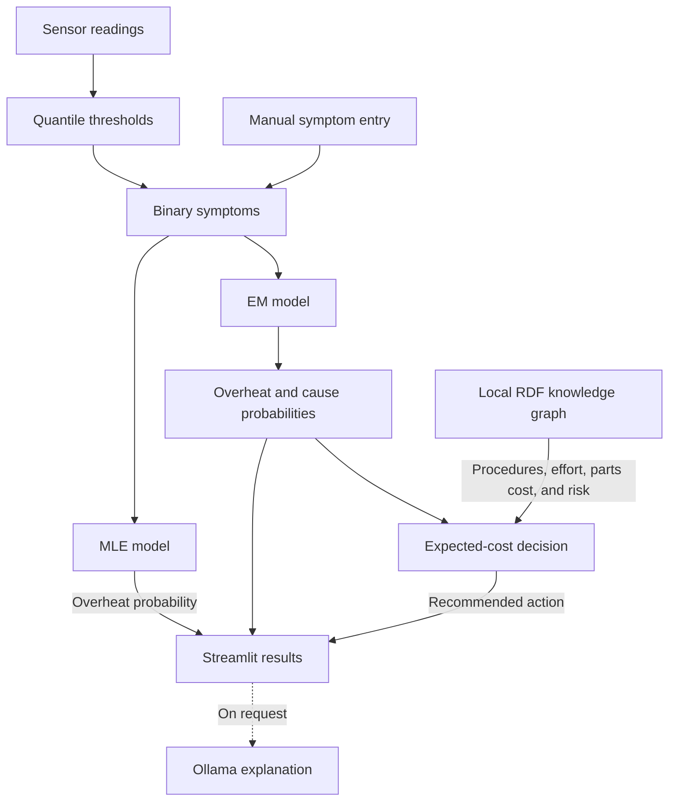

# Industrial Equipment Failure Diagnosis

This decision-support prototype estimates the probability of spindle overheating in a CNC milling machine from a single snapshot of sensor readings or symptoms. It combines a Bayesian network for diagnosis, a local knowledge graph for maintenance procedures, and an expected-cost policy that recommends continuing operation, slowing down, or scheduling maintenance.

See the [project brief](docs/project_description.pdf) and [final presentation](docs/project_presentation.pdf) for the assignment and results.

## How it works



- **Evidence.** The app turns vibration RMS, spindle temperature above ambient, spindle speed, and coolant flow into four binary symptoms using quantile thresholds. You can also enter those symptoms directly.
- **Diagnosis.** The maximum likelihood estimation (MLE) model estimates overheat probability. The expectation-maximization (EM) model also estimates probabilities for five latent causes, including bearing wear, fan fault, and a clogged filter.
- **Recommendation.** The decision module queries the Turtle knowledge graph with SPARQL for procedures that address the inferred causes. It compares the expected costs of continuing, slowing down, and scheduling each candidate procedure, then returns the lowest-cost action.
- **Explanation.** Streamlit shows the diagnosis as JSON and a built-in text summary. With EM selected, it also shows the recommended action and uses the knowledge graph to explain a selected procedure. Ollama can generate a separate explanation on demand.

## Quick start

Use Python 3.12 and create a virtual environment.

**macOS or Linux**

```bash
python3.12 -m venv .venv
source .venv/bin/activate
python -m pip install -r requirements.txt
```

**Windows PowerShell**

```powershell
py -3.12 -m venv .venv
.\.venv\Scripts\Activate.ps1
python -m pip install -r requirements.txt
```

From the repository root, launch the app from `src/` so that the data paths in the YAML files resolve correctly.

```bash
cd src
python -m streamlit run machine_diagnosis.py
```

### Optional Ollama explanations

To enable the **Ollama** tab using Docker, run the following once. The app expects the `llama3.2` model at `http://localhost:11434`.

```bash
docker run -d --name ollama14 -p 127.0.0.1:11434:11434 -v ollama:/root/.ollama ollama/ollama
docker exec ollama14 ollama pull llama3.2
```

Use `docker start ollama14` to restart the existing container.

## Retraining and evaluation

From the repository root, run the CLI from `src/` in the same Python environment.

```bash
cd src
python main.py
```

The script retrains both Bayesian networks and overwrites `weights/diagnose_bn_model.pkl`. It then prints the MLE and EM diagnoses for a sample sensor reading, recommends an action, and evaluates the decision policy against [manually specified symptom cases](data/actions/procedures_man.csv).

The [original overheat labels](data/raw/labels.csv) contain no positive examples. The default model configuration instead uses [labels-3.csv](data/processed/labels-3.csv), whose labels are derived from the same telemetry features used to create the model inputs. The hold-out evaluation measures how well the models reproduce these derived labels.

## Project Structure

- `configs/` - YAML configs for each module (BN, KG client, decision policy).
- `data/` - datasets and KG assets:
	- `data/raw/` - source CSVs (telemetry, labels, relations, maintenance, etc.).
	- `data/processed/` - created labels
	- `data/knowledgeGraph/` - the Turtle KG file (`knowledgeGraph.ttl`).
	- `data/actions/` - procedure/action tables used to evaluate decisions.
- `notebooks/` - data preparation, KG construction, and evaluation notebooks.
- `src/` - application code:
	- `src/app/` - Streamlit UI components + explanation/LLM helpers.
	- `src/bn/` - Bayesian Network training and inference.
	- `src/kg/` - Knowledge Graph client and queries.
	- `src/decision/` - Action Decision logic (cost-based ranking).
- `weights/` - trained BN model pickle files.
